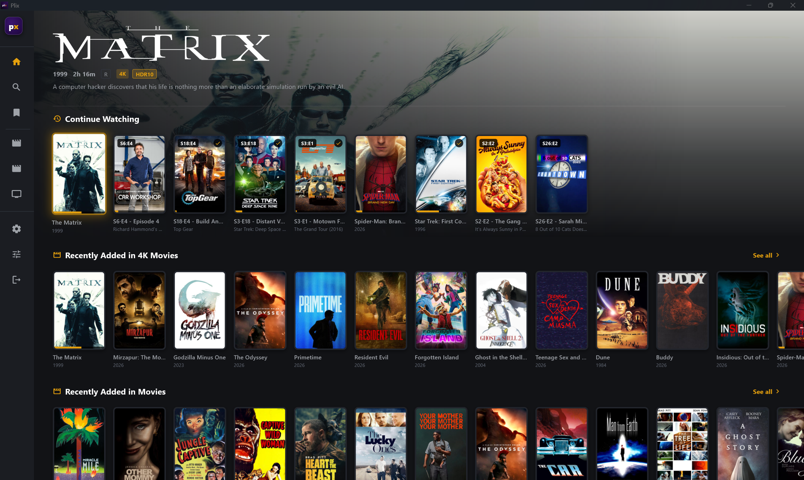
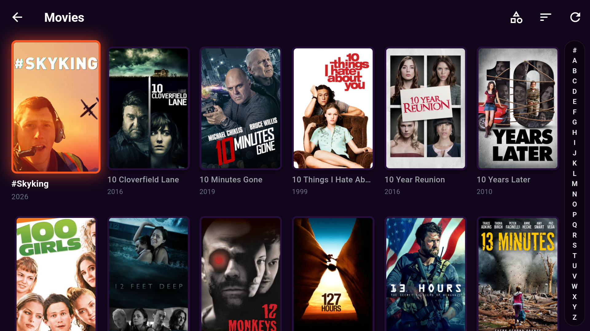
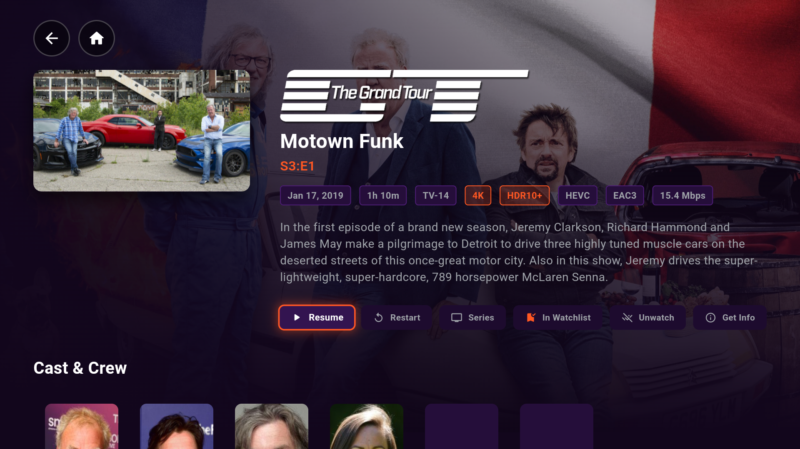
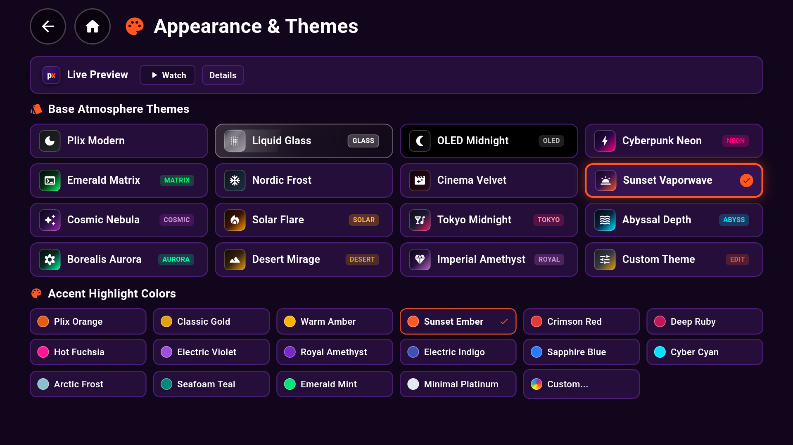
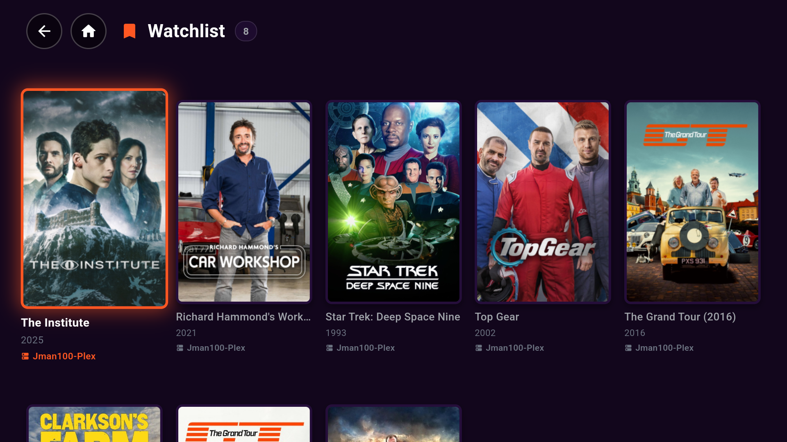
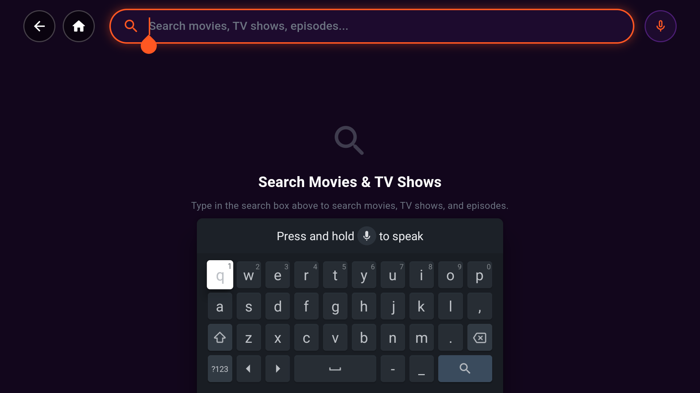

<div align="center">

  

  # Plix

  **A modern, lightweight, and unified media streaming client for Plex & Jellyfin.**

  [](https://github.com/Jman100/plix/releases/latest)
  [](#downloads)
  [](LICENSE)
  [](https://plix.jman100.com)

  <br />

  <p align="center">
    <a href="#key-features">Key Features</a> •
    <a href="#screenshots">Screenshots</a> •
    <a href="#downloads">Downloads</a> •
    <a href="#architecture">Architecture</a> •
    <a href="#building-from-source">Building</a> •
    <a href="#privacy--security">Privacy</a>
  </p>

  

</div>

---

## 🌟 Overview

**Plix** is a cross-platform media client engineered from the ground up for personal home theater and desktop setups. Designed as a lean, responsive alternative to bloated web-wrapped clients, Plix seamlessly blends multiple **Plex** and **Jellyfin** servers into a single cohesive library—complete with native hardware-accelerated playback, rich metadata backdrops, universal watchlists, multi-user profiles, and dynamic atmospheric theming.

---

## ✨ Key Features

### 🎬 Unified Multi-Server Media
- **Simultaneous Server Connections**: Connect to one or multiple Plex and Jellyfin servers simultaneously over LAN or remote SSL.
- **Blended Continue Watching & Favorites**: Aggregate "Continue Watching" rails and pin favorite libraries across different servers on a single screen.
- **Unified Watchlist**: Add movies and TV series across your servers with smart GUID resolution and one-click bookmarking.

### 👥 Multi-User Profiles & Ephemeral Guest Mode
- **Independent Profiles**: Create distinct local user profiles with independent server bindings, personalized theme styles, custom avatars, and separate watch progress.
- **PIN Protection**: Secure sensitive profiles with 4-digit PIN locks and TV remote numpad navigation.
- **Ephemeral Guest Mode**: One-tap guest viewing that isolates playback, prevents main account watch progress bleed, and automatically terminates on exit.

### ⚡ Direct Play & Hardware Transcoding
- **Native Android / TV Engine**: ExoPlayer (Media3) with direct pass-through for Dolby Atmos / TrueHD / DTS:X and true HDR10 / Dolby Vision output.
- **Desktop Direct Play**: libmpv backend (`media_kit`) for Windows and Linux with seamless multi-format container support.
- **Dynamic Jellyfin & Plex Transcoding**: Adaptive HLS profile ladders with server-side hardware acceleration (Intel QSV, NVENC, VAAPI) and real-time transcode telemetry reporting.

### 🎨 Atmospheric Themes & Customization
- **16+ Built-in Atmospheres**: Choose from *Sunset Vaporwave*, *Emerald Matrix*, *Liquid Glass*, *Cyberpunk Neon*, *OLED Midnight*, and more.
- **Real-Time Live Preview**: Instant live canvas updates when testing presets and accent colors.
- **Custom Hex Palettes**: Full custom palette builder with surface, card, border, and glow color controls.
- **TV Theme Music**: Ambient theme audio played seamlessly during show and movie detail inspection.

### 📺 10-Foot Leanback & Desktop UI
- **Remote D-Pad Focus Engine**: Custom-tuned D-pad navigation, alphabet jump rails, and software keyboard lifting.
- **Fast Search**: Instant search execution on Enter/Submit with zero typing lag on TV remotes.

---

## 📸 Screenshots

<div align="center">

### 📺 Android TV Experience

| Movies Library & Alphabet Jump Rail | Episode Details & Clearlogo Title Art |
|:---:|:---:|
|  |  |

| Atmosphere & Theme Customizer | Universal Watchlist |
|:---:|:---:|
|  |  |

### 🖥️ Desktop & Playback Engine

| Direct Play Engine & Playback Controls | TV Series & Ambient Backdrops |
|:---:|:---:|
|  |  |

| Multi-Server Search & Filtering | Unified Home Hub |
|:---:|:---:|
|  |  |

</div>

---

## 📥 Downloads

Ready-to-use binaries are published with every stable release:

| Platform | Format | Download |
|:---|:---|:---|
| **Android TV / Android** | `.apk` (Universal) | [Download Latest APK](https://github.com/Jman100/plix/releases/latest/download/plix_android.apk) |
| **Windows 10 / 11** | `.exe` (Installer x64 & ARM64) | [Download Windows Installer](https://github.com/Jman100/plix/releases/latest/download/plix_windows.exe) |
| **Debian / Ubuntu / Mint** | `.deb` (x86_64) | [Download Debian Package](https://github.com/Jman100/plix/releases/latest/download/plix_linux.deb) |
| **Arch Linux / Manjaro** | `.pkg.tar.zst` | [Download Arch Package](https://github.com/Jman100/plix/releases/latest/download/plix_linux_arch.pkg.tar.zst) |
| **Generic Linux** | `.tar.gz` (Portable) | [Download Portable Tarball](https://github.com/Jman100/plix/releases/latest/download/plix_linux_portable.tar.gz) |

You can also visit the official website at [**plix.jman100.com**](https://plix.jman100.com) for release notes, changelogs, and direct updates.

---

## 🛠️ Architecture & Tech Stack

Plix is built on modern cross-platform Flutter with platform-native video acceleration backends:

```
plix/
├── lib/
│   ├── models/            # Data models (PlexMediaItem, PlixProfile, etc.)
│   ├── screens/           # Main UI screens (Home, Player, Library, Details, Appearance)
│   ├── services/          # Media, Auth, Timeline, Profiles, Update, and Guest services
│   └── widgets/           # TV focus cards, jump rails, modal dialogs, and navigation
├── android/               # Native Android/TV shell with ExoPlayer (Media3) integration
├── windows/               # Win32 runner with libmpv hardware video pipeline
├── linux/                 # Linux GTK bundle with libmpv video pipeline
└── web_site/              # Static release landing page & download manifests
```

- **Frontend**: Flutter 3.24+ / Dart 3.5+
- **Video Playback (Android)**: Google ExoPlayer (Media3) via native Android platform channel
- **Video Playback (Desktop)**: `media_kit` with native `libmpv` shared libraries
- **Storage**: `shared_preferences` with scoped multi-profile namespace partitioning
- **Network**: Strict TLS verification, custom User-Agent isolation, chunked streaming download guards

---

## 🔨 Building from Source

### Prerequisites
- [Flutter SDK](https://docs.flutter.dev/get-started/install) (`^3.5.4` or newer)
- **Android**: Android SDK (API 34) & JDK 17
- **Windows**: Visual Studio 2022 with C++ desktop development workload + [Inno Setup 6](https://jrsoftware.org/isdl.php) (for installer generation)
- **Linux**: `libmpv-dev`, `libgtk-3-dev`, `libepoxy-dev`, `pkg-config`

### 1. Clone the repository
```bash
git clone https://github.com/Jman100/plix.git
cd plix
```

### 2. Install dependencies
```bash
flutter pub get
```

### 3. Run in Debug Mode
```bash
# Run on connected Android device or TV
flutter run -d android

# Run on Windows Desktop
flutter run -d windows

# Run on Linux Desktop
flutter run -d linux
```

### 4. Build Release Packages
```bash
# Android APK
flutter build apk --release

# Windows Executable
flutter build windows --release

# Linux Bundle
flutter build linux --release
```

---

## 🔒 Privacy & Security

Plix is built with an absolute privacy-first philosophy:
- **No Third-Party Telemetry**: Zero analytics, trackers, advertising SDKs, or background metric collectors.
- **Direct Connection Only**: Plix communicates exclusively with your designated Plex and Jellyfin servers, and GitHub for release checking.
- **Isolated Guest Mode**: Ephemeral sessions guarantee that guest viewing leaves no traces, prevents timeline reporting to servers, and purges upon closing.
- **Cryptographic Update Verification**: All updates are validated against strict SHA-256 manifest signatures and restricted to trusted HTTPS domains.

---

## 📄 License

Distributed under the MIT License. See [LICENSE](LICENSE) for more information.
